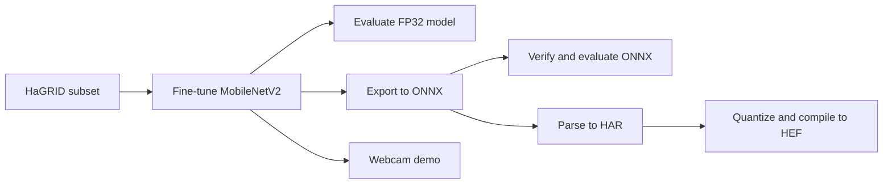

# HaGRID Gesture Recognition: MobileNetV2 on Hailo-10H

Hand gesture classification (24 classes) with a fine-tuned MobileNetV2. The model is trained in PyTorch, exported to ONNX, quantized and compiled to a Hailo-10H HEF, and can be tried live with a webcam.



## Project structure

All scripts live in the repository root because they locate `data/`, `checkpoints/` and `models/` relative to their own folder.

```
hagrid-mobilenetv2-hailo/
├── README.md
├── LICENSE
├── requirements.txt
├── .gitignore
│
├── train_partial_finetune.py        stage 1: backbone frozen except the last 4 blocks
├── train_full_finetune.py           stage 2: full backbone fine-tuning
│
├── compare_checkpoints.py           latest epoch vs best validation epoch on the test set
├── evaluate_pytorch.py              accuracy, per-class accuracy, confusion matrix, report
├── evaluate_onnx.py                 same accuracy evaluation with ONNX Runtime
│
├── export_onnx_runtime.py           ONNX export for ONNX Runtime (opset 17, dynamic batch)
├── export_onnx_hailo.py             ONNX export for the Hailo compiler (opset 13, fixed batch)
├── verify_onnx_export.py            PyTorch vs ONNX output comparison
├── compile_hailo_hef.py             calibration, quantization and HEF compilation
│
├── analyze_model_complexity.py      parameters, MACs and FLOPs
├── benchmark_pytorch_latency.py     inference latency and theoretical FPS
├── demo_webcam_pytorch.py           live webcam demo with FPS and confidence
├── realtime_prototype.py            early, simpler version of the webcam demo
├── check_cuda.py                    quick GPU check
│
├── data/                            dataset (not tracked, see data/README.md)
├── checkpoints/                     trained weights (not tracked, see checkpoints/README.md)
└── models/                          ONNX, HAR and HEF files (not tracked, see models/README.md)
```

## Dataset

The model is trained on a 24-class subset of [HaGRID](https://github.com/hukenovs/hagrid). Images are expected in the `torchvision` `ImageFolder` layout:

```
data/
├── train/<class_name>/*.jpg
├── val/<class_name>/*.jpg
└── test/<class_name>/*.jpg
```

More details are in [data/README.md](data/README.md). Please check the HaGRID license before using or redistributing the data.

Classes: `call`, `dislike`, `fist`, `four`, `grabbing`, `grip`, `like`, `middle_finger`, `mute`, `no_gesture`, `ok`, `one`, `palm`, `peace`, `peace_inverted`, `point`, `rock`, `stop`, `stop_inverted`, `three`, `three2`, `three3`, `two_up`, `two_up_inverted`.

## Installation

```bash
python -m venv venv
# Linux / macOS
source venv/bin/activate
# Windows
venv\Scripts\activate

pip install -r requirements.txt
```

For GPU training install the PyTorch build that matches your CUDA version from [pytorch.org](https://pytorch.org/get-started/locally/). Compiling for Hailo additionally needs the Hailo Dataflow Compiler (`hailo_sdk_client`), which is distributed by Hailo and is not available on PyPI.

## Usage

Run every command from the repository root.

**1. Train**

```bash
python train_partial_finetune.py     # optional stage 1
python train_full_finetune.py        # stage 2, runs 40 epochs per call and resumes from checkpoint_full.pth
```

Checkpoints are written to `checkpoints/`: the latest epoch as `checkpoint_full.pth` and the best validation epoch as `best_validation_full.pth`.

**2. Evaluate and analyze**

```bash
python compare_checkpoints.py
python evaluate_pytorch.py
python analyze_model_complexity.py
python benchmark_pytorch_latency.py
```

**3. Export to ONNX**

```bash
python export_onnx_runtime.py        # writes onnx/mobilenetv2_hagrid_epoch37.onnx
python export_onnx_hailo.py          # writes models/hagrid_mobilenetv2_epoch37_hailo.onnx
```

`verify_onnx_export.py` and `evaluate_onnx.py` read `models/hagrid_mobilenetv2_epoch37.onnx`, so copy or rename the ONNX Runtime export to that path before running them:

```bash
python verify_onnx_export.py
python evaluate_onnx.py
```

**4. Compile for Hailo-10H**

Parse the Hailo ONNX export into a HAR file first (see below), then:

```bash
python compile_hailo_hef.py          # models/hagrid_mobilenetv2.har -> models/hagrid_mobilenetv2.hef
```

**5. Live demo**

```bash
python demo_webcam_pytorch.py        # press q to quit
```

## Evaluation

The scripts report the following metrics. Accuracy is measured on the held-out test set.

| Script | Reports |
|---|---|
| `compare_checkpoints.py` | test loss and accuracy of the latest and the best validation checkpoint |
| `evaluate_pytorch.py` | overall accuracy, per-class accuracy, confusion matrix, precision, recall and F1 |
| `evaluate_onnx.py` | overall and per-class accuracy of the exported ONNX model |
| `verify_onnx_export.py` | maximum and mean output difference between PyTorch and ONNX |
| `analyze_model_complexity.py` | parameters, MACs and FLOPs |
| `benchmark_pytorch_latency.py` | average, minimum and maximum latency and theoretical FPS |

## Hailo deployment notes

- Target architecture: `hailo10h`.
- The ONNX file written by `export_onnx_hailo.py` must be parsed into a HAR file with the Hailo Dataflow Compiler before `compile_hailo_hef.py` can run. The model input is named `input` and the output is named `output`.
- Calibration uses 512 random training images, resized to 224x224 and normalized with the ImageNet mean and std, in NHWC layout. Inputs must be normalized the same way at inference time unless the normalization was added to the HAR model.

## Pretrained files

Trained checkpoints and compiled models are too large for the repository and are published under [Releases](../../releases) when available.

## License

This project is released under the MIT License, see [LICENSE](LICENSE). The HaGRID dataset and the Hailo software are covered by their own licenses.
